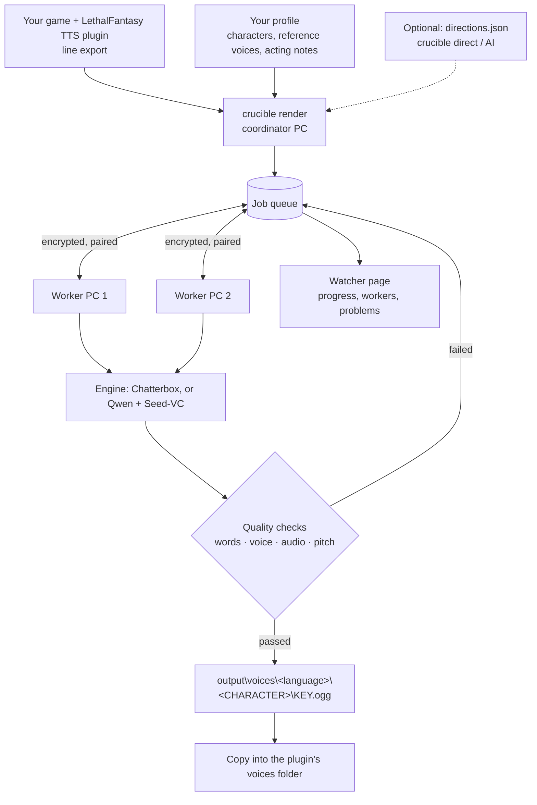

# LethalFantasy Voice Crucible

Text in, magical voices out. Voice Crucible renders voice packs for the
[LethalFantasy TTS](https://github.com/EPIC3D/LethalFantasy-TTS) plugin on your own NVIDIA GPU(s) –
one machine or several on your local network.

> **Beta – tested on Windows 11 with NVIDIA GPUs only.** It works for us; please report what does not.

- Speaks every dialogue line of the game in the characters' voices – from **your own game's** line export.
- Checks every line automatically (all words spoken, start not cut off, same voice, clean audio) and renders
  failed lines again.
- Default packs with Chatterbox; optional **acting packs** (Qwen3-TTS + Seed-VC) with per-line acting directions.
- Several PCs can render together; progress in a small web page (the watcher).
- Not included (yet): the Memory Orb audiobook (`voices\<language>\STORY\`) – the plugin plays it, but Voice
  Crucible does not render it.

## How it works



## Quick start

1. Unzip into a folder on an SSD (e.g. `D:\VoiceCrucible`), run **`setup.cmd`** – it shows what it will
   download and asks first.
2. Nothing to prepare for the voices: the bundled **`lethalfantasy` profile** has the demo voices of the
   LethalFantasy TTS plugin. Want your own? [docs/PROFILES.md](docs/PROFILES.md).
3. Export the game's lines with the plugin (`[Developer] ExportLines = true`, start the game once).
4. Run `coordinator.cmd`, then once `pair.cmd` (code from the coordinator), then `worker.cmd`.
5. `crucible.cmd render --lines "<game>\BepInEx\LethalFantasyTTS"` – watch it with `watcher.cmd`.
6. The pack is in `output\voices\`; `crucible.cmd report` lists lines with problems.

Step by step: [docs/INSTALL.md](docs/INSTALL.md) · more PCs: [docs/WORKERS.md](docs/WORKERS.md) ·
settings: [docs/CONFIG.md](docs/CONFIG.md) · profiles: [docs/PROFILES.md](docs/PROFILES.md) · problems: [docs/TROUBLESHOOTING.md](docs/TROUBLESHOOTING.md) · **FAQ: [docs/FAQ.md](docs/FAQ.md)**

## System requirements

| | Minimum | Recommended |
|---|---|---|
| OS | Windows 11 (others untested) | Windows 11 |
| GPU (worker) | NVIDIA RTX 20 / GTX 16, 8 GB VRAM, driver 570+ | RTX 40/50, 12–16 GB VRAM |
| Disk | ~11 GB (default packs), ~22 GB with acting | SSD / NVMe |
| RAM | 16 GB | 16 GB or more |

A PC without a supported GPU can still run the coordinator. AMD and Intel GPUs are not supported (yet).
Details and measured speeds: [docs/GPU.md](docs/GPU.md).

## Safety and transparency

- Nothing is installed outside the Voice Crucible folder: no admin rights, no PATH changes, no background
  service, no autostart. Uninstall = delete the folder. `INSTALLED.txt` lists every installed file set and where it is.
- Every download – what it does, source, license, size – is shown before it starts:
  [docs/DOWNLOADS.md](docs/DOWNLOADS.md).
- Workers open no port; they connect out to your paired coordinator only (encrypted, pinned certificate,
  local network only).
- Updates happen only when you start them; downloads are signature-checked. Threat model:
  [docs/SECURITY.md](docs/SECURITY.md).
- No personal data is collected or sent. The only thing that can leave your network is game text sent to an
  online AI director – only if you choose one, and the command asks first.

## Reporting bugs

Please open an issue: <https://github.com/EPIC3D/LethalFantasy-VoiceCrucible/issues> and attach the output of

```
crucible.cmd diagnose
```

(saved as `logs\diagnose.txt`). It contains only technical facts – versions, OS, GPU, driver, VRAM, settings
and recent log lines – with IP addresses, computer name, user name and keys removed. Please check it before
posting. We never ask for personal data or a full dxdiag.

## Game content

LethalFantasy is made by **LadyAlice**. This is an unofficial fan tool, not affiliated with or endorsed by
the game's author. It contains no game text; it reads the lines from your own copy of the game.

## No warranty

Voice Crucible is a free hobby project, provided **as is, without warranty of any kind** and without
liability (see [LICENSE](LICENSE)). It downloads large third-party components and uses your GPU heavily –
use it at your own risk.

## License

Code: MIT (see [LICENSE](LICENSE)) – except one small bridge file to Seed-VC, which is GPL-3.0.
Third-party engines and model weights are downloaded from their own sources under their own licenses –
see [docs/LICENSES.md](docs/LICENSES.md).

## Related

- [LethalFantasy TTS](https://github.com/EPIC3D/LethalFantasy-TTS) – the BepInEx plugin that plays the voice
  packs in the game.

## Support

If you enjoy the game, please support its author, LadyAlice, first:
<https://www.patreon.com/cw/LadyAliceR18>.

If you'd also like to support this tool:

[](https://ko-fi.com/E6Z42AUOBQ)
