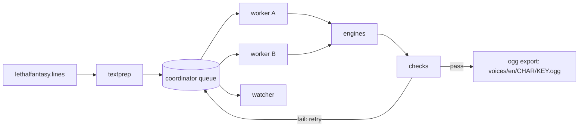

# Voice Crucible – architecture

Voice Crucible renders voice packs for the **LethalFantasy TTS** plugin on your own NVIDIA GPU(s).
It is LethalFantasy-focused, but the engine core is kept separate from the game-specific parts.

## Principles

| Principle | What it means in practice |
|---|---|
| Safe | Workers only connect *out* to the coordinator; pairing code + token; LAN only; no remote code updates; no background service or autostart; files written only inside the install folder. |
| Transparent | Every download is listed (source, size, SHA-256, licence) and confirmed before it starts; plain-text logs; every line has a visible pass/fail reason. |
| Documented | User guide, GPU guide, multi-worker guide, security model, licences, troubleshooting. |
| Easy to configure | One commented TOML file with sane defaults; advanced options in their own section. |
| Easy to follow | Web watcher: workers, VRAM/GPU%, progress, ETA, failures; summary report at the end. |
| Not a monolith | Small packages with one job each, connected through narrow interfaces (see below). |
| Maintainable | Short English docstring on every module, class and function; type hints; tests for the critical parts. |

## Repository layout

```
LethalFantasy-VoiceCrucible/
  voicecrucible/
    core/            # shared building blocks, no engine or game knowledge
      config.py      #   load + validate voicecrucible.toml
      jobs.py        #   Job / Take / Result data classes
      queue.py       #   persistent job queue (SQLite), leases, retries
      audio.py       #   load/save, trim, loudness, ogg export
      log.py         #   structured logging to file + console
    engines/         # one module per TTS / VC engine, all behind engines/base.py
      base.py        #   Engine interface: load(), render(batch) -> takes, unload()
      qwen.py        #   Qwen3-TTS (VoiceDesign + Base clone)
      chatterbox.py  #   Chatterbox
      qwen_vc.py     #   acting pipeline: Qwen VoiceDesign -> Seed-VC to the fixed reference voice
      tone.py        #   "test" engine: beeps, no model (try workers without downloads)
      seedvc.py      #   thin wrapper that runs the separately installed Seed-VC (GPL-3.0) as a process
    vc_bridge/       # GPL-3.0 bridge script, runs inside the Seed-VC environment (never imported)
    checks/          # defect filter, each check independent, behind checks/base.py
      base.py        #   Check interface: run(take) -> CheckResult(passed, reason, score)
      words.py       #   Whisper: all words spoken, first word not clipped
      similarity.py  #   resemblyzer speaker similarity
      quality.py     #   UTMOS floor
      pitch.py       #   F0 ceiling
      onset.py       #   lead-in silence / bad onset
    textprep/        # text -> speakable text (engine independent)
      clean.py       #   strip rich-text tags, symbols, placeholders
      stutter.py     #   natural stuttered onsets
      pronounce.py   #   respelling lexicon
    directors/       # optional acting-direction step, runs BEFORE rendering, writes directions.json
      base.py        #   Director interface, directions file load/save (mode none = no file, file = load it)
      api.py         #   any OpenAI-compatible chat API (Ollama, LM Studio, Claude, OpenAI, OpenRouter)
    coordinator/     # the machine that owns the queue and the watcher
      app.py         #   HTTP API (HTTPS, self-signed cert pinned at pairing)
      scheduler.py   #   hands jobs to workers by free VRAM / speed
      pairing.py     #   6-digit pairing code -> per-worker token
      discovery.py   #   LAN UDP beacon so workers find it after DHCP changes
    worker/          # runs on every GPU machine (also on the coordinator itself)
      client.py      #   connect, heartbeat, claim job, upload result
      runner.py      #   load engine, render batch, adapt batch size on OOM
      gpu.py         #   nvidia-smi / torch checks, VRAM-based batch size
    watcher/         # web UI served by the coordinator (static files + small API)
    installer/       # first-run setup and support
      manifest.py    #   read downloads.toml (components, sources, licenses, sizes)
      gpucheck.py    #   driver/GPU compatibility report before installing anything
      disk.py        #   free space and drive type (HDD / SSD / NVMe)
      layout.py      #   runtime\ folders + env vars that keep everything inside the install folder
      setup.py       #   `crucible setup`: choose, show, ask, uv sync, Seed-VC (pinned zip + checksum)
      inventory.py   #   INSTALLED.txt (folders and packages with version, size, path)
      diagnose.py    #   `crucible diagnose`: redacted facts for bug reports
      update.py      #   `crucible update`: manual, Ed25519-signed, rollback
    (root)           # env.cmd, setup.cmd, crucible.cmd, coordinator.cmd, worker.cmd – short, readable launchers
    lethalfantasy/   # everything game-specific lives here
      lines.py       #   import lines (in-game export, Weblate read-only)
      naming.py      #   KEY[__he|she|they].ogg, AKIPO/RED/BLUE folders
      filters.py     #   never voice narration / player answers
      emotions.py    #   expression -> engine settings
    cli.py           # `crucible setup | pair | coordinator | worker | render | report`
  profiles/lethalfantasy/   # data, not code: characters, expressions.json, pronunciation.json, refs
  config/voicecrucible.example.toml
  downloads.toml     # the complete, human-readable download list
  uv.lock            # pinned Python dependencies
  docs/
  tests/
```

Dependency rule: `core` depends on nothing; `engines`, `checks`, `textprep` depend only on `core`;
`worker` and `coordinator` combine them; `lethalfantasy` is the only package that knows the game.
A new engine or check = one new file implementing the base interface, registered by name in the config.

## Data flow



## Directing (separate, optional step)

- `crucible direct` produces `directions.json` (per line: scene, intent, subtext, delivery). It is plain
  JSON: the user can read and edit it before rendering, and re-render any number of times without AI.
- Modes: `none` (default), `file`, `api`. We plan to ship a ready `directions.json` (keys + acting
  notes, no game text – mention it when asking LadyAlice), so most users never need an AI.
- `api` mode: base URL + model + optional key. The key comes from an environment variable or a
  separate file on the coordinator, is never logged and never sent to workers. Before starting it
  shows where the data goes and how many lines; cloud providers receive the game text (documented).
- The director brief is a versioned text file in `profiles/lethalfantasy/`.

## Coordinator ↔ worker protocol

- Worker finds the coordinator by **broadcasting a UDP query** on the LAN; the coordinator answers with
  its ID, API port and certificate fingerprint (the worker listens on no port). Fallbacks: hostname / IP
  from the config, then the last known address. Identity = coordinator/worker ID, never the IP → DHCP-safe.
- **Pairing (once):** the coordinator shows a one-time code (10 characters, valid 10 min, burnt after 5
  wrong tries). The worker sends HMAC(code, certificate fingerprint it sees | worker ID), receives a
  token, and pins the certificate. Only token hashes are stored. Revoke a worker in the watcher.
- Transport: HTTPS (TLS ≥ 1.2, self-signed EC certificate made on first start, pinned by fingerprint),
  HTTP/1.1, JSON bodies, size limits, only private/loopback client addresses.
- **Reference voices** travel as content-addressed assets: a line names its voice by SHA-256, the worker
  fetches it once (`/api/asset`), verifies the hash and caches it. Only files put into the coordinator's
  asset store can be fetched.
- **Check settings** (enabled checks, thresholds, name respellings) come from the coordinator with every
  job, so all workers judge alike. Passed takes are encoded to OGG Vorbis on the worker (no ffmpeg).
- Install extras: base (coordinator, watcher, test engine – no torch), `gpu` (PyTorch 2.11 cu128),
  `checks`, `chatterbox` (its torch 2.6 pin is overridden so RTX 50 works).
- The watcher is a separate plain-HTTP page bound to 127.0.0.1 (not reachable from the network).
- **Work loop:** `heartbeat` (VRAM, GPU%) → `claim` (gets a batch with a lease) → `result` (audio + check
  results). Lease timeout → the batch goes back to the queue (a worker can drop out safely).
- The worker opens **no port**, runs no commands, only reads/writes inside its own folder.
- **Updates: manual only**, started by the user: `crucible update` / `update.cmd` checks the GitHub
  releases, shows old/new version, changelog and size, asks, downloads, verifies SHA-256 **and an
  Ed25519/minisign signature** (public key in the code, private key only with the maintainer), keeps the
  old version in `previous\` (`crucible update --rollback`), never touches `work\`, `output\`, config.
  No background checks, no remote updater; the coordinator never updates workers. Needs a public repo.
- Version check: workers send their version; the watcher flags outdated workers; an incompatible
  protocol version is refused with a clear message.

## Installation

1. `gpucheck`: NVIDIA GPU present? driver ≥ 570? VRAM? → clear report, stop with a helpful message if
   unsupported (AMD/Intel/Mac: coordinator only).
2. Show `downloads.toml` (uv, Python, PyTorch cu128, chosen engines, model weights – each with source,
   size, SHA-256, licence) and the total size; download only after confirmation.
   **uv is bundled** in the release zip (`uv.exe`, MIT/Apache-2.0, licence included, version + SHA-256
   in the download list): nothing is installed system-wide, no admin rights, not added to PATH. Short,
   readable launchers (`setup.cmd`, `coordinator.cmd`, `worker.cmd`) call the bundled uv only.
3. Optional components (Seed-VC GPL-3.0, second engine) are separate choices.
4. Everything goes into one folder the user picks; uninstall = delete the folder.
   - **Install target is chosen by the user** (default suggestion not on the system drive if another
     drive exists) and can be changed later (move the folder; no absolute paths stored inside).
   - **Disk space shown up front**, per component and in total (download size and size on disk), plus
     the free space on the target drive; refuse to start when it does not fit, with a clear message.
   - Also show the expected size of the rendered output (per character / whole pack).
   - **Install log for the user:** every install/update/removal writes a plain-text log
     (`logs/install_<date>.log`, plus an always-current `INSTALLED.txt` in the install folder) listing each
     installed component and package with version, size and its exact folder on disk – so the user always
     knows what was installed and where.
   - **Drive type warning:** detect HDD / SATA SSD / NVMe for the target (Windows: `Get-PhysicalDisk`
     MediaType/BusType; Linux: `/sys/block/*/queue/rotational`; unknown = say so). On an HDD warn that
     models (several GB) load much slower at every start and recommend an SSD/NVMe; the output folder
     may stay on an HDD (small files, written once). Advice only – the user decides.
   - uv's Python, package cache and model downloads are pointed into the install folder
     (`UV_PYTHON_INSTALL_DIR`, `UV_CACHE_DIR`, `HF_HOME`), so nothing lands on C: unnoticed and the
     size estimate is honest.

GPU support (must be in `docs/GPU.md`):

- **Tested platform so far: Windows 11 + NVIDIA.** Linux / Windows 10 expected to work but untested
  (documented as such). Code stays cross-platform: `pathlib`, no Windows-only calls outside small,
  clearly marked helpers.

- **NVIDIA (official):** one PyTorch build (CUDA 12.8) covers RTX 20, 30, 40, 50 and GTX 16. RTX 20 /
  GTX 16 have no bf16 → fp16/fp32 fallback, slower, Qwen in fp16 to be tested. GTX 10 and older: not
  supported. 8 GB VRAM recommended, 6 GB = smaller engines/batches only.
- `gpucheck` decides by capability (compute capability, bf16, free VRAM), not by card name.
- **AMD (experimental):** PyTorch ROCm, Linux first (RX 7000/9000); Windows support is new and changing.
- **Intel Arc (experimental):** PyTorch XPU backend (Windows + Linux); untested with our engines.
- Engines never hard-code `cuda`: the device comes from `worker/gpu.py`.
- Without a supported GPU the machine can still run the coordinator/watcher.

## Documentation plan

`README` (what it is, safety summary, **minimum and recommended system requirements** – GPU/VRAM, RAM,
disk, OS – filled in from real measurements, plus "Reporting bugs") · `docs/INSTALL.md` · `docs/GPU.md` · `docs/WORKERS.md`
(multiple machines, firewall, pairing) · `docs/SECURITY.md` (threat model, what it never does) ·
`docs/CONFIG.md` · `docs/LICENSES.md` (code + weights) · `docs/TROUBLESHOOTING.md` · `docs/DEVELOPING.md`
(how to add an engine/check).

## Code conventions

- Every module starts with a one-paragraph docstring; every public class/function has a short English
  docstring (what it does, not how).
- Type hints everywhere; small functions; no global state outside `config`.
- No module over ~300 lines – split it instead.

## Milestones

1. Skeleton: `core`, config, logging, CLI, docs stubs.
2. Worker + coordinator + pairing + discovery + watcher (port today's worker/watcher logic).
3. Engines + checks + textprep ported from the current `tools/`.
4. `directors` (none / file / api) + `lethalfantasy` package + end-to-end render of a small test set.
5. Installer (`gpucheck`, `downloads.toml`, uv lock) + test on clean machines with different GPU generations (e.g. RTX 40 and RTX 50 series).
6. Documentation pass, then the first release.
