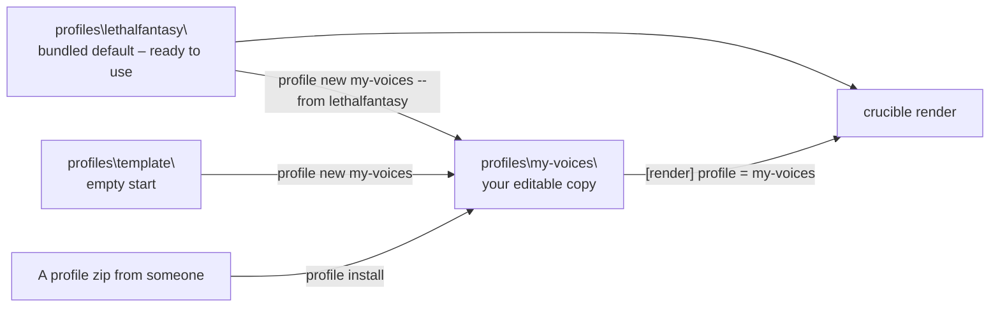

# Profiles

A **profile** holds everything about the characters you render: who speaks, their reference voices, how each
game expression is acted, how names are pronounced, and the brief for an AI director.

## The bundled default: `lethalfantasy`

Voice Crucible comes with a ready profile – **the voices and settings of the LethalFantasy TTS demo**:
Chatterbox reference voices for Akipo, Red and Blue, the tuned emotion table, expression meanings and name
pronunciation. No acting director (no character descriptions, no acting references). It is the default
(`[render] profile = "lethalfantasy"`), so rendering works right after setup.

It is **part of the program**: every Voice Crucible update replaces it with the maintainer's current version.
Don't edit it – make a copy instead.

## Your own profile

- **Copy the default and change it:** `crucible.cmd profile new my-voices --from lethalfantasy`
- **Start empty:** `crucible.cmd profile new my-voices` (from the template; the speakers are added from the
  game export when you run `render --dry-run`, voice pack folders come from `plugin_folders.json`)
- **Install a profile someone shared:** `crucible.cmd profile install <zip>`

Then set `[render] profile = "my-voices"` in `voicecrucible.toml`. Updates never touch your own profiles.
`crucible.cmd profile list` shows all profiles (`*` = active).

### What to change

1. **Voices** – put one reference clip per character into `voices\chatterbox\` (and `voices\acting\` for
   acting packs): 10–25 seconds of clean speech, WAV/FLAC/OGG, named as in `characters.json`. Any voice works,
   also a male one. Only use voices you have the right to use.
2. `characters.json` – per speaker: `folder` (the plugin's voice pack folder, LethalFantasy: `AKIPO`, `RED`,
   `BLUE`), `voices`, `chatterbox_adjust`, and for the acting engines `bible` / `persona` (voice and
   personality).
3. Optional: `pronunciation.json`, `emotions.json`, `expressions.json`, `director_brief.md` – each file has
   comments.

A speaker added in a later game version is added to your profile automatically and skipped until it has a
reference clip.

## What is in a profile

| File | What it holds |
|---|---|
| `profile.json` | name, title, version |
| `characters.json` | speakers: voice pack folder, key prefix, reference clip per engine, acting description, Chatterbox adjustment |
| `plugin_folders.json` | game speaker ID → the plugin's voice pack folder (used when speakers are added automatically) |
| `voices\` | reference clips |
| `emotions.json` | game expression → engine settings (Chatterbox sliders, Qwen styles), words replaced in directions |
| `expressions.json` | what each game expression means for the acting |
| `pronunciation.json` | name respellings for the engines (subtitles stay unchanged) |
| `director_brief.md` | instructions and character notes for an AI director |

## Re-rendering after a change

Lines that were already rendered stay as they are. To render them again, delete their files from `output\`
(or the whole character folder) and run `render` again – lines already in the queue are not queued twice.

## Sharing a profile

Zip the profile folder itself (one folder with `profile.json` inside). Others install it with
`crucible.cmd profile install <zip>`; an existing profile of the same name is first copied to
`profiles\<name>.backup-<date>\`. Only share voices and texts you are allowed to share.
