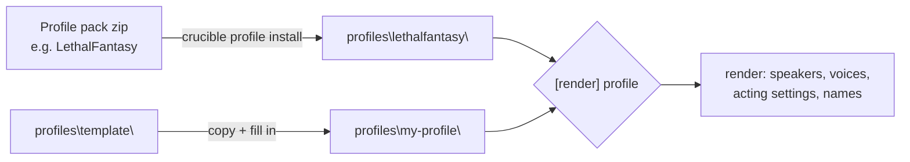

# Profiles

A **profile** holds everything about the characters of a game: who speaks, their reference voices, how they
act, how names are pronounced, and the brief for an AI director. Voice Crucible itself ships only an empty
**template** (`profiles\template\`); real profiles are separate downloads (**profile packs**), so their
character data is not part of this repository.



## What is in a profile

| File | What it holds |
|---|---|
| `profile.json` | name, title, version, which Voice Crucible versions it is made for |
| `characters.json` | speakers: voice pack folder, key prefix, reference voice per engine, acting description (`bible`, `persona`), Chatterbox adjustment |
| `voices\` | reference clips (10–25 s of clean speech per character and engine) |
| `emotions.json` | game expression → engine settings (Chatterbox sliders, Qwen styles), words replaced in directions |
| `expressions.json` | what each game expression means for the acting |
| `pronunciation.json` | name respellings for the engines (subtitles stay unchanged) |
| `director_brief.md` | instructions and character notes for an AI director |

## Install or update a profile pack

```
crucible.cmd profile install VoiceCrucible-Profile-LethalFantasy.zip
crucible.cmd profile list
```

- The pack goes to `profiles\<name>\`. The default profile is `lethalfantasy`; another one is chosen with
  `[render] profile = "<name>"` in `voicecrucible.toml`.
- **Updating** = installing a newer pack the same way. Before anything is overwritten, the current folder is
  copied to `profiles\<name>.backup-<date>\` – your changes are never lost. Reference voices that the new pack
  does not bring stay in place.
- **Program updates** (`crucible.cmd update`) never touch `profiles\` (only the template is refreshed).
- After a profile update, lines that were already rendered stay as they are. To render changed lines again,
  delete their files from `output\` (or the whole character folder) and run `render` again – lines already
  in the queue are not queued twice.

## Your own changes

Small changes (a pronunciation, a slider) can be made directly in the installed profile – the next pack
update keeps them in the backup folder, so you can copy them over again. For bigger changes, work in a copy:

1. copy `profiles\lethalfantasy\` to `profiles\my-lethalfantasy\` and change `"name"` in its `profile.json`,
2. set `[render] profile = "my-lethalfantasy"`.

Pack updates then never touch your copy; compare it with the new pack when you like.

## A profile for another game, or from scratch

Copy `profiles\template\`, rename the folder and fill in the files (each has comments). A speaker that the
game export names but `characters.json` does not have yet is added automatically with defaults when you run
`render` – its lines are skipped until it has a reference voice.

## Making a profile pack

Zip the profile folder itself (the zip contains one folder, e.g. `lethalfantasy\`, with `profile.json` and
the other files). Increase `"version"` in `profile.json` for every release of the pack. Only include voices
and character texts you are allowed to share.
