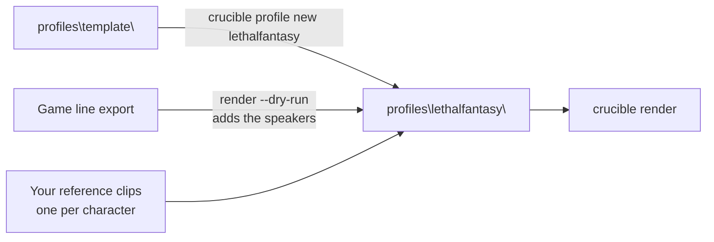

# Profiles

A **profile** holds everything about the characters you render: who speaks, their reference voices, how they
act, how names are pronounced, and the brief for an AI director. Voice Crucible ships only an empty
**template** (`profiles\template\`) – you create your own profile from it. No character data is part of
this repository.

## Create your profile (once)

1. `crucible.cmd profile new lethalfantasy`
   Creates `profiles\lethalfantasy\` from the template (`lethalfantasy` is the default profile name; another
   name needs `[render] profile = "<name>"` in `voicecrucible.toml`).
2. `crucible.cmd render --lines "<game>\BepInEx\LethalFantasyTTS" --dry-run`
   Reads the game's export and **adds every speaker** to `characters.json` with defaults. It prints the
   file name each character's reference clip needs, e.g. `voices\chatterbox\<Name>.wav`.
3. Open `profiles\lethalfantasy\characters.json` and check each speaker:
   - `folder` – the voice pack folder **the plugin expects**. For LethalFantasy these are `AKIPO`, `RED`
     and `BLUE`; the automatic default is the game's speaker name in capitals, so change the two Twins'
     folders to `RED` and `BLUE`.
   - `bible` / `persona` – a short description of voice and personality (used by the acting engines).
4. Put one **reference clip** per character into `voices\chatterbox\` (and `voices\acting\` for acting packs):
   10–25 seconds of clean speech of the voice you want, WAV/FLAC/OGG, named as in `characters.json`.
   Only use voices you have the right to use.
5. Optional: `pronunciation.json` (how names are spoken), `expressions.json` and `emotions.json` (how each
   game expression is acted), `director_brief.md` (notes for an AI director). Each file has comments.

Then render as usual. A speaker added in a later game version is picked up the same way: it is added
automatically and skipped until it has a reference clip.

## What is in a profile

| File | What it holds |
|---|---|
| `profile.json` | name, title, version |
| `characters.json` | speakers: voice pack folder, key prefix, reference clip per engine, acting description, Chatterbox adjustment |
| `voices\` | reference clips |
| `emotions.json` | game expression → engine settings (Chatterbox sliders, Qwen styles), words replaced in directions |
| `expressions.json` | what each game expression means for the acting |
| `pronunciation.json` | name respellings for the engines (subtitles stay unchanged) |
| `director_brief.md` | instructions and character notes for an AI director |

## Updates and backups

- **Program updates** (`crucible.cmd update`) never touch `profiles\` – only the template is refreshed.
  Compare your profile with a new template when you like (new options appear there first).
- Keep a copy of your profile folder; it is your work.
- After changing a profile, lines that were already rendered stay as they are. To render them again, delete
  their files from `output\` (or the whole character folder) and run `render` again.

## Sharing profiles (optional)

A profile can be shared as a zip that contains the profile folder (with `profile.json`). Someone else
installs it with `crucible.cmd profile install <zip>` – an existing profile of the same name is first copied
to `profiles\<name>.backup-<date>\`, and reference clips the pack does not bring stay in place. Only share
voices and character texts you are allowed to share.

`crucible.cmd profile list` shows the profiles you have (`*` = active).
