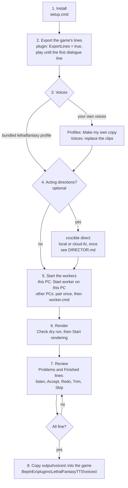
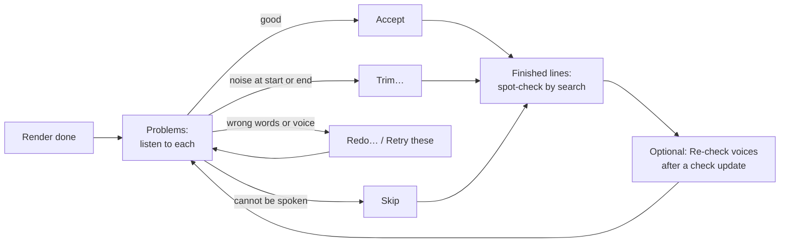

# The watcher – step by step

The watcher is the small web page of Voice Crucible (`watcher.cmd`, <http://127.0.0.1:5132>). It shows the render,
starts every task with a button, and is where you listen to the voices and fix the ones that came out wrong. It only
works on the computer where `coordinator.cmd` runs. Every button runs the same `crucible.cmd` command you could type
yourself.

New here? Read the workflow below once – the page follows the same order from top to bottom.

## The whole workflow

You can pause at any step and close the windows; the queue remembers where it was. Next time start
`coordinator.cmd`, open the watcher and press **Resume**.

## The panels, top to bottom

### Progress

- The bar and numbers: finished, rendering, waiting and failed lines, time left, runtime and speed of all workers.
  "estimating…" means the first lines are still being rendered.
- **Reset** counts from zero again (for a new piece of work). Nothing is deleted.
- **Directing** (only while `crucible direct` runs): how many scenes and lines the AI director has done and its time
  left. The worker on the directing PC waits ("standby – directing on this PC") and starts when directing is done.
- **Unfinished render**: shown when the coordinator starts with lines still waiting from last time. It waits for you:
  **Resume** goes on, **Cancel render** drops the waiting lines (finished voices stay).

### Workers

One row per computer that renders: state, current batch, GPU, VRAM, load and temperature (orange/red when the card
gets hot or slows itself down), lines done and failed, speed, version.

- **Pause rendering / Resume** – workers finish their current batch, then wait. Use it before you close anything.
- **Stop** (per worker) – that worker hands its unfinished lines back and waits for new work. It stays connected.
- **Shutdown** (per worker) – the worker program on that PC closes. To use it again, start `worker.cmd` there.
- **Start worker on this PC** – starts a worker here (pairs it with this coordinator automatically).
- **Update workers** – asks workers that allow it to update themselves from GitHub (signature-checked). Update the
  workers first, this coordinator last.

### Pairing

Another computer joins once with a code: press **New pairing code**, run `pair.cmd` on the other PC and type the code
(valid once, for 10 minutes). **Unpair** removes a computer for good. Details: [WORKERS.md](WORKERS.md).

### Profiles and Voices

A profile holds the characters, their reference voices, the emotion table and how names are pronounced. The bundled
`lethalfantasy` profile is replaced by updates – press **Make my own copy** before you change anything.
**Voices** lists each character's reference clip per engine: ▶ listens, **Change…** replaces it with your own clip
(5–30 s of clean speech). Details: [PROFILES.md](PROFILES.md).

### Render

1. **Game lines (read from)** – the plugin's export folder, `<game>\BepInEx\LFTTS-export`. Only read.
2. **Voice pack (written to)** – where the voices go (default: `output\`). Voice Crucible never writes into the game.
3. **Engine** – Chatterbox (default, 8 GB cards), Breeze TTS 2 (best acting, 12 GB+), Qwen + Seed-VC.
4. Optional: **Only keys starting with** (e.g. `AKIPO_DIALOGUE_EVENT_HUG`), **At most** N lines, **Takes per line**
   (tries before a line counts as failed), **Render again** (also lines that already have a file).
5. **Check (dry run)** shows what would be rendered – nothing is queued. Then **Start rendering**.

Other buttons: **Retry failed lines** (all of them), **Report** (writes `report.tsv` with every problem line),
**Re-check voices** (today's checks on existing files, no rendering – failures go to Problems), **Audiobook** (the
Memory Orb pages). A running task shows its progress with **Pause** and **Stop**.

### Output

Where the voice pack is and how many files each character has. **Diagnose (for a bug report)…** collects technical
facts for a GitHub issue (IP addresses, computer and user names and keys are removed – read it before posting).

### Finished lines

The lines that passed, newest first. Every line has an **ID** (`#1234`) – use it to find a line again or to report it.
Search by ID, key or text. Hover the key to see the expression, settings and neighbouring keys.

- ▶ plays the voice; 📁 shows the file in Explorer.
- **Redo…** renders the line again with a new take (the old file is kept as `.bak.ogg`). For Chatterbox lines you can
  change exaggeration and cfg_weight for this one round; for every engine you can change the **spoken text** (e.g.
  `Stooomp!` for `Stomp!`) – the subtitle in the game never changes.
- After a Redo: **▶ new / ▶ old**, then **Keep new** or **Restore old**.
- **Trim…** opens the take editor (below).
- **Skip** leaves a line without a voice (e.g. it cannot be spoken well).

### Problems

Lines that failed a check. "will retry" lines are rendered again by themselves; "failed" lines used up their takes –
the best take is in the pack and listed in `report.tsv`. The reason says what was wrong, e.g.
`words: first word missing – heard: "…"`, `similarity: other voice (0.58 < 0.72)`, `pitch: pitch too high`.

The checks are strict on purpose; a good take sometimes fails (a name spelled differently by the speech recogniser,
a laugh before the line). Listen first, then:

- **Accept** – the take is fine: use it and mark the line done.
- **Redo…** – a new take (optionally with other settings or spoken text).
- **Trim…** – cut a noise off the start or the end, or insert a pause.
- **Skip** – no voice for this line.
- **Retry these** renders the failed lines shown in the list again; **Clear list** hides them (nothing is deleted).

The search box finds problems by ID, key, text or reason (`similarity`, `first word`, …).

### Edit the take (Trim…)

The whole waveform; the yellow line is the point, the green tick where the speech is thought to start.
Listen with **▶ from here**, then:

- **Cut before here** – removes a click, breath or mumble before the line (a short silence and a fade-in are added).
- **Cut after here** – removes an extra word or noise at the end (a fade-out and a short silence are added).
- **Insert pause here** – 0.25–1 s of silence, e.g. a dramatic pause between sentences.

Each change keeps the version before it as `.bak` – **Restore old** brings it back.

## Reviewing a whole pack

